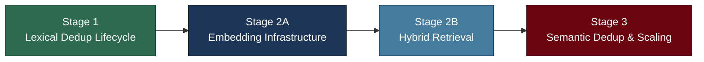

# Lesson Memory System Update — Staged Roadmap

> **Date**: 2026-09-30
> **Purpose**: Outlines the phased approach to upgrading the lesson learning & memory system's deduplication, embedding, retrieval, and scaling capabilities.

---

## Overview

The lesson memory system upgrade is organized into four stages with strict dependency ordering. Each stage produces a testable, independently valuable deliverable that the next stage builds upon.

---

## Source Documents

| Document | Purpose |
|----------|---------|
| [fix-lesson-duplication-detection.md](fix-lesson-duplication-detection.md) | Root cause analysis, implemented downstream fix, proposed upstream solution |
| [review-lesson-duplication-detection.md](review-lesson-duplication-detection.md) | Architectural review: 8 identified problems with solutions |
| [analysis-lesson-duplication-detection.md](analysis-lesson-duplication-detection.md) | Expert review: what was right, wrong, and missed |

---

## Stage 1: Lexical Dedup Lifecycle (COMPLETED ✅)

**Status**: Completed in PR #10 and merged into `main` in PR #7.

**Deliverables**:
- Normalized `are_rules_similar()` with unified `0.75` Jaccard threshold
- Ingestion and promotion guards with reinforcement tracking
- Rule-text similarity clustering for compaction (`cluster_lessons_by_similarity()`)
- SQLite concurrency guard (`BEGIN IMMEDIATE`)
- Lesson decay and sunset candidate flagging (`flag_low_utility`) with operational pipeline padding
- `--retire-sunsets` flag in CLI (`localai-compact-lessons`, `localai-compact-active`)
- Textual Compaction TUI (`compact_app.py`) with 3-way tab cycling (`[Pending Queue]`, `[Active Lessons]`, `[Sunset Candidates]`)
- Full test suite passing (393/393)

**Implementation Plan**: [stage-1-implementation-plan.md](stage-1-implementation-plan.md)

---

## Stage 2A: Embedding Infrastructure (COMPLETED ✅)

**Status**: Completed on branch `feat/embedding-infrastructure-stage-2a`.

**Deliverables**:
- Verified and adopted resident local embedding model (`nomic-embed-text:latest`, 768 dimensions)
- Built native `ollama_embed` MCP tool in `sysadmin/mcp_ollama/server.py` adhering to Rule 7
- Implemented core embedding generation module (`sysadmin/mcp_core/embeddings.py`)
- Integrated lifecycle hooks: auto-embed on insert, update on rule change, staleness tracking via `schema_meta`
- Added `localai embed-lessons` CLI command and backfilled 100% of active lessons (19/19)
- Surfaced embedding badges (`[EMBEDDED: 768d]` / `[NO-VEC]`) and `e` on-demand embed keybinding in Compaction TUI (`compact_app.py`)
- Validated `sqlite-vec` vector and hybrid search with dimension guard and fallback
- Full test suite passing (429/429)

**Implementation Plan**: [stage-2a-implementation-plan.md](stage-2a-implementation-plan.md)

---

## Stage 2B: Hybrid Retrieval Upgrade

**Goal**: Wire hybrid search (BM25 + vector similarity) into the lesson retrieval pipeline as the primary search path, using prompt goal context for dense vector matching.

**Scope**:
- Upgrade `collect_relevant_lessons()` in `pipeline.py` to embed the **task prompt/goal context** (rather than isolated 2-word tags) for vector retrieval
- Calibrate hybrid fusion using Reciprocal Rank Fusion (RRF) or normalized min-max weighting
- Build query embedding pipeline with ephemeral pipeline-run caching
- Validate retrieval quality against known query → lesson pairs
- Ensure zero-regression graceful degradation when embeddings or Ollama are unavailable

**Key Metrics**: Hybrid search retrieves relevant lessons that FTS5-only search misses. Zero regression on existing retrieval quality.

**Implementation Plan**: [stage-2b-implementation-plan.md](stage-2b-implementation-plan.md)

---

## Stage 3: Semantic Dedup & Scaling

**Goal**: Introduce semantic duplicate detection that catches vocabulary-shifted and code-shifted duplicates, combined with vector pre-filtering and TUI clustering badges.

**Scope**:
- Build `are_rules_similar_v2()` using a **tiered disjunctive decision gate** (`lexical_pass OR semantic_pass OR hybrid_pass`) to solve vocabulary/code shift gaps
- Use scalar `vec_distance_cosine()` candidate pre-filtering for sub-second clustering (under 2,000 lessons), documenting `vec0` virtual table indexing for scale
- Surface similarity origin badges (`[SEMANTIC]`, `[LEXICAL]`, `[HYBRID]`) and cosine similarity metrics in Compaction TUI (`compact_app.py`)
- Add cross-category semantic deduplication
- Benchmark scaling performance up to 1,000+ lesson corpus
- Optional MinHash/LSH fallback for non-vector environments

**Key Metrics**: Semantic duplicates (different vocabulary/code snippets, same meaning) are caught. Compaction triage clearly distinguishes semantic vs lexical clusters.

**Implementation Plan**: [stage-3-implementation-plan.md](stage-3-implementation-plan.md)

---

## Dependency Chain & Risk Assessment

| Stage | Depends On | Primary Risk | Mitigation |
|-------|-----------|-------------|------------|
| **1** | Nothing | Test fixture regressions from dedup behavior changes | `deduplicate: bool = True` parameter; update fixtures first |
| **2A** | Stage 1 | Embedding model quality/performance on short lesson text | Include benchmarking step before committing to a model |
| **2B** | Stage 2A | Weight tuning: BM25 vs vector balance may need iteration | Build with configurable weights; test with real queries |
| **3** | Stage 2B | ANN accuracy on small corpus (sqlite-vec may not shine at <100 items) | Keep lexical fallback; ANN is a pre-filter, not the sole signal |
